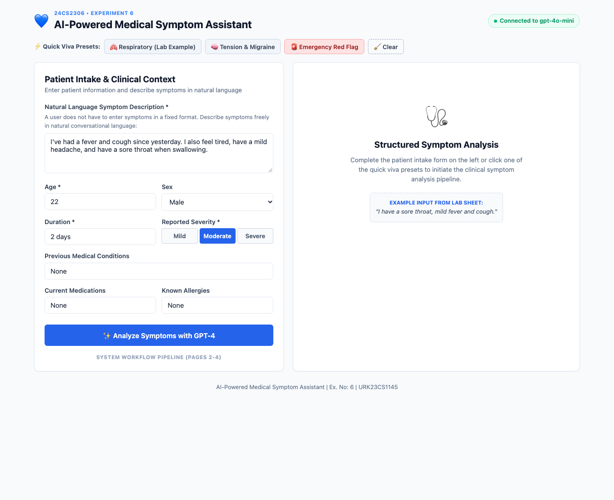

# AI-Powered Medical Symptom Assistant using GPT-4

[](https://python.org)
[](https://flask.palletsprojects.com/)
[](https://opensource.org/licenses/MIT)

**Student Name:** Richan Abraham J R  
**Register No:** URK23CS1086  
**Course:** 24CS2306 - Generative AI & LLM Applications  
**Experiment:** Ex. No.: 6  
**Date:** 19-9-2026  

---

## 📌 Aim
To develop an AI-powered medical symptom assistant using GPT-4 that analyzes user-reported symptoms, identifies possible associated conditions, generates relevant follow-up questions and provides general guidance regarding professional medical attention.

## 📖 Description
A clinical symptom assessment assistant featuring free-text NLP symptom extraction, patient demographics intake, comorbidity analysis, emergency red-flag screening, triage acuity categorization (Emergency / Urgent / Moderate / Low), clarifying diagnostic questions, and timestamped clinical report file export.

---

## 🖥️ Output Screenshot


---

## ⚙️ Module Design & Responsibilities

| Module | Responsibility |
| :--- | :--- |
| **Input & Profile Module** | Collects conversational natural language chief complaints and validates patient demographics. |
| **Symptom Extraction Module** | NLP extraction of discrete clinical entities (fever, cough, sore throat, etc.). |
| **Context Module** | Evaluates symptom duration, severity rating, comorbidities, and medications. |
| **Triage & Safety Module** | Screens for emergency red flags and assigns triage urgency levels. |
| **Clinical Reasoning Module** | Evaluates candidate conditions with reasoning and generates follow-up clarifying questions. |
| **Save Module** | Persists formatted clinical reports to disk as timestamped .txt and .json files in /reports/. |

---

## 🚀 Getting Started

### 1. Clone the Repository
```bash
git clone https://github.com/Richan-A27/gpt_exp6.git
cd gpt_exp6
```

### 2. Create and Activate Virtual Environment
```bash
python3 -m venv venv
source venv/bin/activate  # On Windows: venv\Scripts\activate
```

### 3. Install Dependencies
```bash
pip install -r requirements.txt
```

### 4. Run the Web Application
```bash
python app.py
```
Open [http://127.0.0.1:5006](http://127.0.0.1:5006) in your web browser.

### 5. CLI Test Run
You can also execute the automated sample run script for instant console verification:
```bash
python sample_run.py
```

---

## 📊 Sample Test Case
`Age: 22 | Sex: Male | Symptoms: 'Fever, cough, tiredness, headache, and sore throat when swallowing' | Severity: Moderate`

---

## 📄 License
This project is licensed under the MIT License - see the LICENSE file for details.
